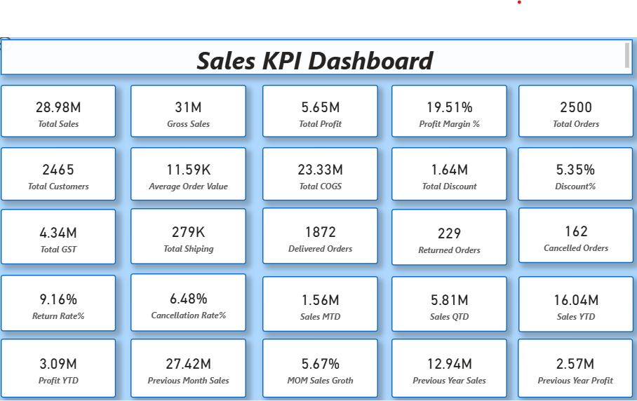

# Sales KPI Dashboard

## 📊 Project Overview
The Sales KPI Dashboard is designed to analyze overall sales performance, profitability, customer behavior, and order trends. It provides key business insights through interactive KPIs and visual metrics to support data-driven decision-making.

## 🎯 Key Performance Indicators (KPIs)

| KPI | Value |
|---|---:|
| Total Sales | 28.98M |
| Gross Sales | 31M |
| Total Profit | 5.65M |
| Profit Margin | 19.51% |
| Total Orders | 2,500 |
| Total Customers | 2,465 |
| Average Order Value | 11.59K |
| Total COGS | 23.33M |
| Total Discount | 1.64M |
| Discount % | 5.35% |
| Total GST | 4.34M |
| Total Shipping | 279K |
| Delivered Orders | 1,872 |
| Returned Orders | 229 |
| Cancelled Orders | 162 |
| Return Rate | 9.16% |
| Cancellation Rate | 6.48% |
| Sales MTD | 1.56M |
| Sales QTD | 5.81M |
| Sales YTD | 16.04M |
| Profit YTD | 3.09M |
| Previous Month Sales | 27.42M |
| MOM Sales Growth | 5.67% |
| Previous Year Sales | 12.94M |
| Previous Year Profit | 2.57M |

## 📸 Dashboard Screenshot

## 🔍 Key Insights
- Analyzed total sales, gross sales, and overall profitability.
- Evaluated profit margin and cost of goods sold (COGS).
- Monitored customer count, total orders, and average order value.
- Analyzed delivered, returned, and cancelled orders.
- Tracked sales and profit performance using MTD, QTD, and YTD metrics.
- Compared current sales performance with previous month and previous year.
- Evaluated discount, GST, and shipping costs.

## 🛠️ Tools & Technologies
- Microsoft Power BI
- Data Visualization
- KPI Analysis
- Business Intelligence

## 💡 Business Objective
The main objective of this dashboard is to monitor business performance, identify sales trends, evaluate profitability, and provide meaningful insights that help businesses make better decisions.

## 👩‍💻 Author
**Innama Akhtar**

Aspiring Data Analyst
